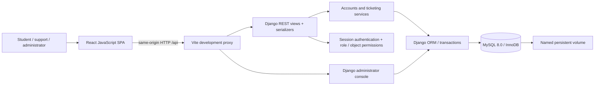
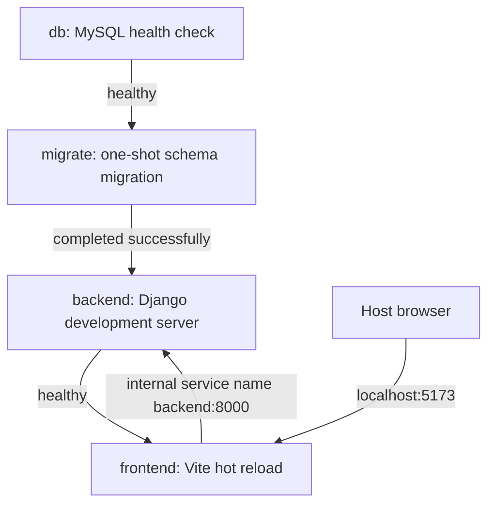

# Architecture and engineering decisions

Status: implementation target, with verification evidence maintained in the sprint report. Scope: [FR-01–FR-12](../requirements/scope.md).

## Modular monolith

One Django application process contains an accounts module and a ticketing module. HTTP views handle request/response and permissions; serializers validate and represent data; services own state changes and transaction boundaries; query functions own visibility and ORM loading. Django ORM provides persistence directly: an extra repository abstraction would duplicate it without a second storage implementation. React consumes the same REST contract documented by drf-spectacular. No microservices, event bus, Redis, or background worker is required for the selected scope.

## Technology choices

| Choice | Reason / tradeoff |
| --- | --- |
| Python 3.12 / Django 5.2 family | User-required ecosystem; built-in authentication, admin, ORM, transactions, migrations. Exact resolved dependencies are locked in `backend/requirements.txt`. |
| DRF + django-filter + drf-spectacular | Validated serializers, consistent REST responses, standard filtering/pagination, generated schema and Swagger UI. |
| MySQL 8.0 / mysqlclient | Explicit user requirement; relational constraints and row locks match private ticket ownership and concurrent claims. No SQLite settings or test fallback. |
| React / JavaScript / Vite / React Router | Required UI stack with browser routes and development reload. No TypeScript application files. |
| TanStack Query | Server state, mutation refresh, and visibility-scoped cache cleanup; local form/filter state stays in components/URL parameters. |
| Docker Compose | User-required complete runtime, isolated dependency installation, repeatable MySQL-backed tests, health-gated startup. |
| Django sessions + CSRF | Browser-only, same-origin app; HttpOnly session cookie avoids persistent bearer tokens in browser storage. Login itself must explicitly enforce CSRF. |

## Boundaries and security

- Students query only their own tickets. All detail/actions resolve through the same visibility function; another student's ID returns 404. Support/admin query the university queue. Dashboard aggregates start from that same queryset.
- Role is a persisted, constrained enum. Only administrators enter Django admin; support is not granted Django `is_staff`. Public account mutation endpoints are absent.
- Inputs have length/choice/category validation. Mutations use services and `transaction.atomic`; assignment/status/reply operations lock the ticket and recheck current state. No user-supplied owner, assignee, role, or arbitrary status fields pass through model updates.
- Production defaults disable debug, require secure cookies/HTTPS, and enable security headers. The Compose development profile binds host ports to loopback. Production deployment still requires a trusted TLS reverse proxy, allowed hosts/origins, static assets, backups, and real credentials; it is not claimed as deployed.
- Database access uses a non-root application account. Test privileges are scoped to `test_<database>`. The database is internal-only; data survives container recreation in a named volume.
- No cross-origin API access is needed, so no permissive CORS middleware is installed. Vite preserves Origin/Host and Django verifies CSRF tokens and the explicitly trusted local origins.

## Errors and operations

DRF errors use `{ "error": { "status": 400, "details": { "field": ["message"] } } }`, with the appropriate 400/403/404/409/429 code. A database readiness endpoint returns 503 without credentials or exception text. Unexpected production exceptions use safe generic responses. Only the migration service migrates on normal startup; dependent application services do not launch if it fails.

The default Compose command is for development with bind mounts. The backend image's default command runs Gunicorn; Compose deliberately overrides it with Django runserver. No container or volume belonging to another project is modified.

## Caching strategy

- **Server:** no shared response/data cache in version one. Each read queries authoritative MySQL data with scoped queries, joins, indexes, and pagination. There is no measured repeated expensive read requiring Redis. This avoids stale authorization or assignment state. Session storage is Django's database session backend, not a ticket cache.
- **Client:** TanStack Query caches authenticated-user session, category, queue, metrics, reply, and event queries in memory. Default stale time is zero; data becomes stale immediately and refetches on mount/focus/reconnect. Unused entries have a five-minute garbage-collection lifetime, not a freshness guarantee.
- **Hit/miss:** an existing query entry can render cached data while a refetch runs; absent entries fetch from the API and show loading. Mutations invalidate affected queue, detail, reply/event, and metrics keys after success. Server authorization and transactional validation always run on writes; cached UI state cannot authorize anything.
- **Account boundary:** clear the entire query cache on login/logout and session-expiry redirect to prevent data from the previous account appearing in a later session. No ticket data is persisted to localStorage or a service worker.
- **Staleness:** refetch rather than optimism for mutations. A concurrent closed-ticket reply or duplicate claim is rejected by the server and displayed to the user. If future measured load warrants server caching, select public category data first, use a bounded TTL, invalidate on admin change, and test invalidation before adding Redis. Do not cache per-user ticket visibility globally.

## Consulted primary references

Consulted November 26, 2026:

- [Django 5.2 database notes](https://docs.djangoproject.com/en/5.2/ref/databases/).
- [Compose startup order and health dependencies](https://docs.docker.com/compose/how-tos/startup-order/).
- [Vite guide and runtime requirements](https://vite.dev/guide/).
- [DRF session authentication and CSRF](https://www.django-rest-framework.org/api-guide/authentication/#sessionauthentication).
