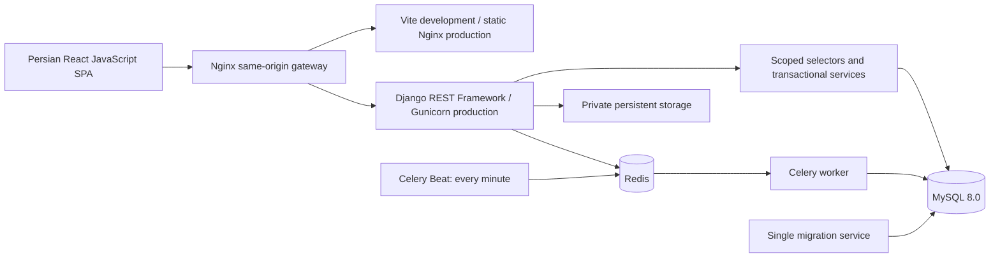

# BNUT architecture — implemented milestone

Updated 2026-11-28. This document supersedes the earlier prototype architecture. The system remains a modular monolith; Django apps are `accounts`, `ticketing`, and `portal`. Portal contains organizational permissions, public content, identity/import, forms, calendars/SLA, notifications and operational APIs. Splitting it into smaller domain apps is a later refactor after contracts stabilize.

HTTP views validate contracts and select visible objects. Ticket services lock and revalidate scope/state inside transactions. The legacy `open` value means submitted/unassigned; assignment transitions to `in_progress`. The five-state implementation is documented in `ticket-lifecycle.md`; the master request's larger lifecycle remains backlog work. Students cannot select operational priority, owner, department independently of category, SLA timestamps, or assignee.

The React router provides public, student, staff/manager and administrator navigation. Student attention counts and personal requests differ from staff assigned queues, manager workload/performance and university administration metrics. Reusable management forms use backend field metadata over authenticated GET endpoints, avoiding development middleware interception of OPTIONS. Backend authorization remains authoritative.

All application dependencies run in containers. Development binds frontend/backend/gateway only to loopback, with source mounts and persistent MySQL, Redis and private-media volumes. Production Compose is standalone: `docker compose --env-file .env.production -f docker-compose.prod.yml ...`; it uses immutable source images, Gunicorn, a multistage static frontend, TLS gateway and an internal application network. Only the gateway exposes ports. Production has not been deployed or end-to-end TLS tested.

Timestamps use Django UTC storage. SLA calendars default to Asia/Tehran; weekdays use Python numbering (Monday=0, Saturday=5). UI dates use the Persian calendar and Asia/Tehran through Intl. Content is plain text rendered by React; there is no raw-HTML rendering.

## Caching and background work

MySQL is authoritative. Redis DB 1 stores the `bnut:public:home:v1` application cache key (Django adds its `bnut` prefix/version), request throttles and worker heartbeat; DB 0 carries Celery messages. The home cache contains only public departments, public published articles and FAQs, with 60-second TTL. Announcements are always filtered live for audience/start/expiry. Cache misses query MySQL; management writes invalidate after transaction commit; cache failures fall back to database reads. Direct database/maintenance edits can remain visible in the home cache for up to 60 seconds. Individual articles/search always revalidate publication/visibility in MySQL. No private ticket querysets are shared in Redis.

The in-memory TanStack Query cache is invalidated after writes. Private requests are cancelled and removed on account switching/logout; public help cache may survive. Polling intervals: tickets/notifications 15 seconds, dashboards 30 seconds, session 60 seconds. No long-lived tokens or ticket content are stored in localStorage.

Beat submits the SLA monitor every minute. It records first-response/resolution warnings/breaches with a unique ticket/trigger/level constraint, notifies currently authorized managers, updates a heartbeat and closes expired resolved requests. Row locks and unique notification keys prevent duplicate alerts. External email/SMS/push delivery is not implemented or enabled. Run exactly one Beat instance; shared worker coordination and configurable multilevel escalation are future work.

Consulted 2026-11-28: [Celery Django integration](https://docs.celeryq.dev/en/stable/django/first-steps-with-django.html), [Django cache framework](https://docs.djangoproject.com/en/5.2/topics/cache/), [DRF release notes](https://www.django-rest-framework.org/community/release-notes/).
