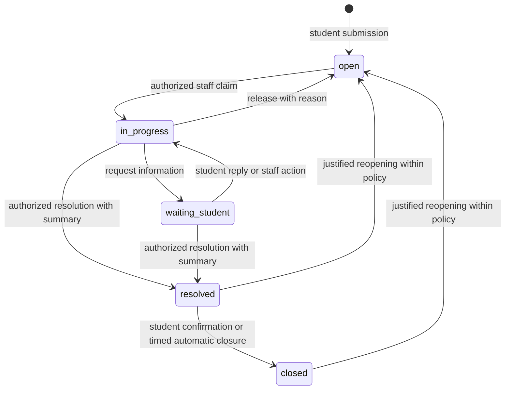

# Implemented ticket lifecycle

Services enforce scope and transitions under `transaction.atomic` and `select_for_update`. Closed/resolved tickets reject new replies/uploads until reopened. Students confirm only resolved tickets; reopening needs a reason and a resolution timestamp within `reopen_days`. Staff resolution/manual closure/reopening/release requires a reason; resolution summary is student-visible. Transfer requires an active destination category in the target department, a reason and transfer permission; it clears assignment, preserves messages/history/forms/deadlines and never downgrades confidentiality. Source staff may lose access immediately after transfer; the transfer response contains only confirmation.

Waiting for student may pause the resolution SLA when policy enables it. Resume extends the existing deadline by working minutes consumed while paused; first-response SLA does not pause. Reassignment/transfer never resets deadlines. Full internal-department waiting, escalation/rejection/cancellation/draft states, per-resolution feedback rounds, stale-version preconditions and submission idempotency keys remain explicitly unimplemented.
