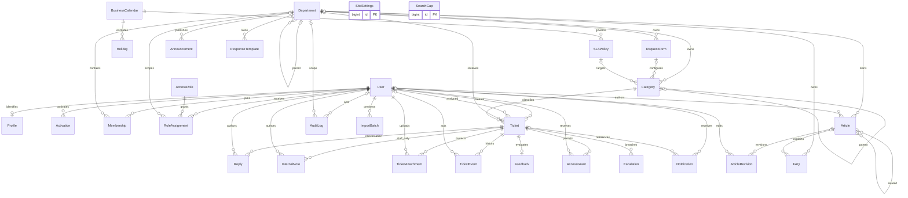

# Implemented database relationships

MySQL 8.0/InnoDB/utf8mb4. Model source and committed migrations are authoritative. This diagram includes all domain models currently migrated; draft tables without operational workflows are identified below.

Ticket has unique UUID tracking number, protected creator/category/department, nullable assignee, constrained status/priority, immutable JSON form snapshot/responses, SLA timestamps and a version counter. Compound indexes support creator/recent, status/recent, category/recent, department/status/recent and assignee/status queries. Separate deadline indexes support monitoring. Existing tickets receive individual UUIDs through a staged nullable/backfill/unique migration; existing organizationally unclassified records remain visible to their student and normal-record administrators until classified.

Membership is unique per user/department; holidays per calendar/date; escalation per ticket/trigger/level; feedback per ticket; notification idempotency keys and activation digests are unique. Organizational/content management APIs support updates/deactivation, not destructive deletion. Events/audits have no mutation API. Django's own auth groups/permissions, sessions and migration tables remain framework infrastructure.

ResponseTemplate and SearchGap currently have schema only. AccessGrant can be provisioned by maintenance ORM but has no emergency-access approval UI. Assignment strategies are stored but only manual claim is operational. Do not equate these tables with completed product features.
