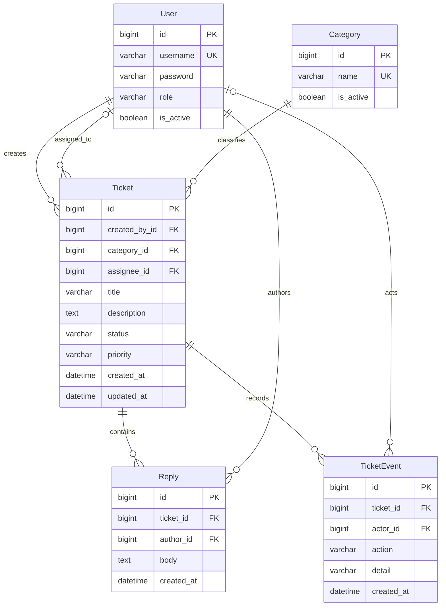

# Database design

Design for the version-one scope; migrations and model names are authoritative once implemented. MySQL 8.0, InnoDB, UTF-8 (`utf8mb4`), strict SQL mode; timestamps stored as timezone-aware UTC, displayed in the browser's local timezone.

`User` extends Django AbstractUser, retaining its standard identity fields, password hash, groups, and permissions relations. Django also manages session, admin log, permission, content-type, and migration tables. They are framework infrastructure, not additional domain entities.

## Integrity and access

| Entity | Constraints and deletion policy |
| --- | --- |
| User | Unique username; constrained student/support/admin role; Django password hashing; admin-console flag derived from role. Created tickets/reply authors protect deletion; deactivate accounts to preserve history. |
| Category | Unique name, active flag. Referenced categories use PROTECT. Deactivate instead of deleting used categories. |
| Ticket | Required title/description/category/creator; constrained status and priority. Assignee nullable with SET_NULL. Creator/category use PROTECT. No ticket deletion API. |
| Reply | Required body, ticket CASCADE, author PROTECT. Immutable through API. |
| TicketEvent | Ticket CASCADE, nullable actor SET_NULL, constrained event action, bounded detail. Created in the same transaction as each mutation; immutable through API/admin. |

Foreign keys receive Django/MySQL indexes. Add composite indexes for student queue `(created_by, -updated_at)` and staff queue `(status, -updated_at)`; stable ordering also uses ID. Replies/events order by `(created_at, id)` within ticket. Titles/descriptions use bounded search for this small prototype; no speculative full-text service. Counts are computed from role-scoped queries, not duplicated counters.

Transactions with `select_for_update` serialize ticket claims, status changes, and replies. Existing assignees cannot be overwritten by simultaneous claims. State validation runs after acquiring the lock. API serializers enforce text lengths and active-category rules; database CHECK constraints defend enum values. Test both validation and concurrent claim behavior using MySQL, not SQLite.
