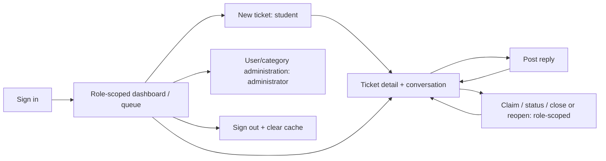

# UI/UX specification

This is a reviewable local design, not a Figma file. Open [wireframes.html](wireframes.html) in a browser. It specifies the main screens before their React implementation. Completed implementation screenshots and browser checks are recorded in the sprint report.

## User flows and navigation

Routes: `/login`, `/tickets`, `/tickets/new`, `/tickets/:id`. `/` redirects to `/tickets`. An unmatched route has a recovery link. Authenticated shell contains the brand, queue link, role-specific new-ticket/admin links, and sign-out. Search/filter/page live in URL query parameters so the queue can be bookmarked and browser navigation works.

## Main screens

| Screen | Layout and interactions |
| --- | --- |
| Login | Two-column introduction and compact labeled credential form. One column on small screens. Show generic credential errors and pending state. Explain administrator-provisioned accounts. No nonfunctional registration/reset links. |
| Queue | Title/description, new-ticket action for students, role-scoped count cards, search/status/priority/category filters, ticket rows, pagination. Each row has an ordinary keyboard-accessible ticket link, status badge, priority, category, assignee, and update time. |
| New ticket | Clearly labeled title/category/priority/description, bounded lengths, help text, field errors, pending submit, cancel link. No categories displays a real actionable empty state rather than a fake option. |
| Detail | Breadcrumb, ticket title/number, status/priority, description and conversation on main column. Metadata, assignment, status actions, activity on right. Stack into one column on small screens. Replies are plain text. Closed tickets display reopen guidance instead of an enabled reply form. |

## Initial design system

- Colors: forest `#174940` for navigation/actions; ink `#182e2a`; warm canvas `#f5f6f2`; white panels; border `#dce4df`; muted `#536b63`; amber `#9a520d`, red `#b42332`, green `#236644` for semantic state text on pale backgrounds. Status also has readable text; color is never the only signal.
- Typography: system UI sans-serif, 15px body, 1.6 line height; 32–38px page titles, 20px section titles, 12px uppercase section labels. No externally loaded font or fabricated university seal.
- Components: AppShell, Button/LinkButton, Badge, Field, Alert, Loading, EmptyState, Pagination, TicketFilters, TicketForm, ReplyForm. Use shared CSS tokens and consistent spacing (4/8/12/16/24/32px).
- Buttons: primary forest, secondary white/border, destructive outlined red. Pending buttons disable repeat submission and include textual progress. Focus rings remain visible.
- Forms: native labels and inputs/selects; required/maxLength constraints plus server validation; errors associated with fields through `aria-describedby` and `aria-invalid`. Use alert/live regions for async feedback. Never rely solely on a placeholder.
- Responsive: sidebar becomes compact header/navigation below 850px; stats and fields wrap; detail columns stack; rows scroll horizontally only inside their table region. Target width 390px without document overflow.
- Accessibility: semantic landmarks/headings, skip link, link-based navigation, keyboard controls, strong text contrast, reduced-motion support, responsive zoom, explicit loading/error/empty states.

## State and error behavior

Forms keep local state. TanStack Query owns API results. All mutations refetch affected results. A 403 on session fetch returns to login; actions display actual server validation/access/conflict errors. A 404 detail page explains that the ticket is unavailable without confirming another student's ticket existence. Retry controls refetch failed reads. Clear cached data when switching accounts. No unimplemented menu item or static demonstration metric appears as live functionality.
